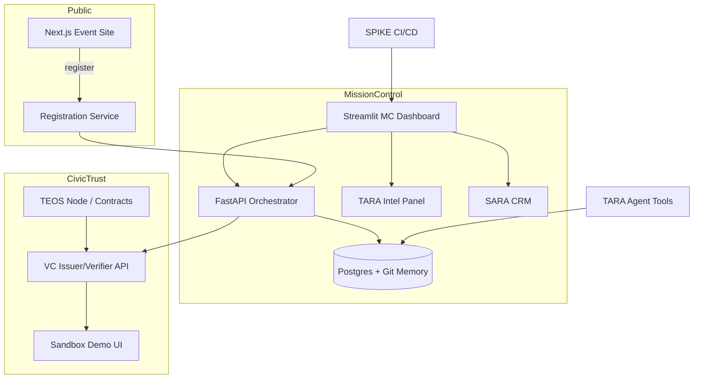
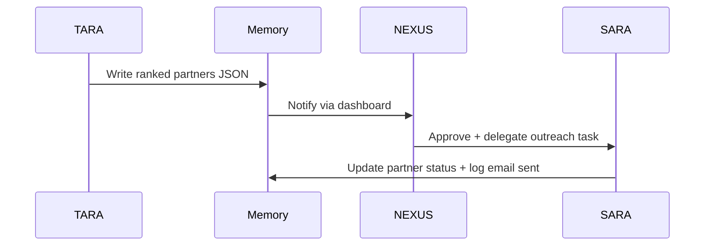

# SPIKE — System Architecture, GitHub Structure, Sprint Roadmap & Streamlit Mission Control
**ConSensus Elmahrosa Alexandria Preparation — ELMAHROSA OS v2.0**

**Agent:** @SPIKE (Engine Manager / CTO)  
**Mandatory Outputs:** Architecture diagrams, repo structures, sprint plans, risk reports.

---

## 1. High-Level System Architecture (for ConSensus Event + OS Mission Control + TEOS Civic DPI Layer)

**Context:** Support the ConSensus Elmahrosa Alexandria event (registration, content, partner CRM, live demos of civic credentials) + persistent ELMAHROSA OS Mission Control (agent orchestration dashboard, portfolio, intel from TARA etc.) + reference implementation of TEOS civic trust components that can be piloted with partners.

**Core Principles (SPIKE):**
- Sovereign-first: Self-hostable, air-gappable options, encryption everywhere, minimal vendor lock.
- Modular / composable on existing DPI (plug into Digital Egypt ID, Smart Africa SATA claims, national payments).
- Fast iteration: Streamlit + FastAPI for dashboards/agents; Next.js for public event site; TEOS/Solana or dedicated L1 for chain layer (current TEOS stack).
- Observable & auditable: All agent actions logged immutably (BOB).
- Zero-trust networking for any internal services.

**Layers:**

```
[ Public / Event Layer ]
- Next.js / React static + SSR event site (landing, agenda, registration, live stream embed, blog)
- Public docs + whitepaper
- SEO + analytics

[ Orchestration / Mission Control Layer (Internal + Controlled Access) ]
- Streamlit Mission Control App (primary for NEXUS + agents)
  - Real-time dashboard (portfolio, KPIs, agent status)
  - TARA intel feed + opportunity ranker
  - SARA outreach CRM + sequence tracker
  - JUNE content calendar + thread publisher stub
  - RAJA campaign funnel + registration stats
  - SPIKE sprint / GitHub / deploy status
  - BOB archive browser + compliance checklist
  - NEXUS exec summary + approval workflows
- FastAPI backend (auth via founder key or SSO, RBAC)
- Shared memory store (Postgres + vector for knowledge layers? or simple JSON + git for v0)
- Agent communication bus (simple @mention parser + task queue, or NATS/Rabbit for scale)

[ Civic Trust / TEOS Integration Layer (Pilotable) ]
- TEOS node(s) (testnet + sovereign mainnet options)
- Verifiable Credential issuer/verifier service (FastAPI + did:key or did:web + BBS+ or Ed25519 signatures, W3C VC + GovStack alignment)
- On-chain governance / audit anchor (smart contracts or TEOS modules for policy hash, participation receipts)
- ZK circuits (if needed for privacy-preserving eligibility) — optional v1
- Integration adapters: Egypt NID stub, mock SATA claim verifier, InstaPay receipt anchor example
- Sandbox UI (Streamlit page or separate) for live demo at event

[ Data & Knowledge Layer ]
- 4 memory layers (see NEXUS/BOB): Founder profile, Elmahrosa KB, TEOS KB, Active Projects (Postgres + file/git backed)
- BOB immutable backups + audit logs
- Vector search over whitepapers, reports, past threads (for agents)

[ Infrastructure ]
- Docker + docker-compose for local dev + single-host deploy
- Kubernetes manifests for scale (optional early)
- CI/CD: GitHub Actions (test, build, deploy to VPS or k8s)
- Secrets: Never in code. Use env + Doppler / 1Password / Vault (BOB)
- Monitoring: Prometheus + Grafana or simple health endpoints + logs to Loki
- Hosting: Sovereign preference — Egyptian DC or self-hosted VPS (Hetzner/OVH with encryption); fallback CDN for public site (Cloudflare with care)
```

**Data Flow Example (TARA discovery → NEXUS approval → SARA outreach):**
TARA tool use → writes ranked JSON to shared memory (git commit or DB) → Mission Control Streamlit shows alert → NEXUS reviews/approves in UI → creates task for SARA → SARA updates CRM state → email sent via automation stub (or manual first) → logged.

**Diagrams (Mermaid — render in GitHub or Obsidian):**





**Security Notes (coord with BOB):** All internal services authenticated + mTLS where possible. Public site read-only. VC issuance requires explicit NEXUS or founder approval for prod keys.

---

## 2. GitHub / Repository Structure Recommendations

**Current state:** Many repos under Elmahrosa org (Elmahrosa-Core, teos-*, etc.). For this initiative, recommend:

**New or dedicated repos (or modules in existing):**
- `elmahrosa-consensus-alexandria` (or `ConSensus-Elmahrosa-Alexandria`) — Event site (Next.js), content, registration, campaign assets. Public.
- `elmahrosa-mission-control` — Streamlit app + FastAPI backend + shared memory schemas. Internal-first (private or org-only with controlled access).
- `teos-civic-dpi` (or module in TEOS core) — Verifiable credentials, issuer, on-chain anchors, adapters, ZK if any, sandbox. Reference implementation + docs. Open source with sovereign license.
- `elmahrosa-os` (this prompt + agent memory, runbooks, BOB archives) — Or keep as meta in Elmahrosa-Core + .github org profile.

**Monorepo alternative (for speed):** One `elmahrosa-sovereign-dpi` monorepo with:
```
/event-site (Next.js)
/mission-control (streamlit + fastapi)
/civic-layer (teos-vc + python)
/docs
/infra (docker, k8s, github actions)
/agents (prompts, scripts for TARA etc if automated)
```

**GitHub features to enable (SPIKE/BOB):**
- Branch protection on main (require PR + 1 review for prod).
- CODEOWNERS (NEXUS + SPIKE for arch, BOB for security).
- Actions for CI (lint, test, build, security scan).
- Projects board or classic for sprint (linked to milestones).
- Releases + tags for artifacts.
- Security advisories + Dependabot.
- Private repos for mission-control + any keys/secrets repos.

**Recommended top-level org structure update:** Add "DPI" or "Events 2026" section in Elmahrosa-Core manifest or new teos-manifest entries.

---

## 3. Sprint Roadmap (2-Week Init + 4-Week Pilot Prep)

**Sprint 0 (This week — Initialization, 5-7 days) — Current**
- [ ] Write this architecture + diagrams (done)
- [ ] Scaffold repos: event-site (Next.js + Tailwind + shadcn), mission-control (streamlit + fastapi + postgres), civic-layer (vc python package)
- [ ] Basic landing page live with JUNE content + registration stub (form posts to sheet or email for now)
- [ ] Mission Control v0.1: Dashboard shell + hardcoded TARA partners from this run + portfolio view + agent status
- [ ] TEOS civic credential demo (simple issuance of "ConSensus Attendee" VC, verify in sandbox Streamlit page). Use existing TEOS or python crypto if chain not ready.
- [ ] GitHub structure + initial PRs + CI skeleton
- [ ] BOB security review gate on all new repos
- **Risk report:** Dependency on real TEOS node for full demo (mitigate with local simulator + note "testnet live at event").

**Sprint 1 (Week 1-2 post-init) — Content + Outreach Ready**
- Full event agenda + speaker placeholders in site.
- Mission Control: Live TARA feed (auto or manual ingest), SARA task queue + email draft UI (or integration), RAJA registration stats pull.
- Civic: Real integration stub with one national DPI mock (Egypt InstaPay receipt or NID hash anchor example).
- Campaign: Automated nurture email sequence (or Zapier/Mailgun first).
- First partner calls supported (demo stable).
- **KPIs (SPIKE):** 3 repos scaffolded + deployed v0.1, 1 working civic demo, 80% test coverage on core, 0 critical vulns in scan.

**Sprint 2-3 (Weeks 3-6) — Pilot & Event Hardening**
- Production-grade auth for Mission Control (founder + NEXUS only first).
- On-chain anchoring for at least one audit event (e.g. "partner MoU signed" hash).
- Event site: Live stream embed, accredited badge printing, on-site check-in stub.
- Full agent memory persistence + BOB backup/restore tested.
- Load test sandbox for 100 concurrent if public demo.
- Documentation: Architecture decision records (ADRs), runbooks, "how to add new agent" .
- **Milestone:** "Ready for ConSensus" — NEXUS can run full Mission Control, 3+ partners have sandbox access, event site handles registrations + content.

**Ongoing:** Bi-weekly sprints post-event. Owner: SPIKE. Reports to NEXUS.

---

## 4. Streamlit Mission Control Architecture (Detailed)

**App structure (multi-page or tabs for v1):**

- `app.py` or `Home.py`: Dashboard (ASCII or nice cards for the Mission Control header, system status, 7 agents online, active projects count, critical tasks, quick "NEXUS approve" buttons).
- `pages/01_TARA_Intelligence.py`: Table of opportunities (from memory JSON or DB), rank/sort/filter, "create SARA task" button.
- `pages/02_SARA_Outreach.py`: CRM table (partner, status, last contact, next action, score), email composer stub (generate from template + send log), sequence status.
- `pages/03_JUNE_Narrative.py`: Content calendar, thread preview + "post" (stub or real X API if keys), press release versions.
- `pages/04_RAJA_Growth.py`: Funnel viz (simple charts with streamlit), registrations table, campaign checklist, lead list export.
- `pages/05_SPIKE_Engine.py`: Current sprint board (from GitHub API or markdown), architecture docs browser, deploy status, risk register.
- `pages/06_BOB_Archive.py`: Searchable docs + security checklist, backup status, audit log viewer.
- `pages/07_NEXUS_Executive.py`: Master roadmap (Gantt-ish table), resource allocation sliders (simulated), priority weights, escalation form, "update memory" button, founder report generator.

**Tech:** streamlit, pandas, plotly or altair for viz, psycopg2 or sqlalchemy, pydantic models for memory, httpx for GitHub/X if integrated. Auth: streamlit-authenticator or simple password + session for v0.1; upgrade to proper later.

**Persistence v0.1:** JSON files in git repo (committed on "save") + Postgres for registrations. Later: full DB + vector store.

**Deployment:** Docker. One-click `docker compose up` for local full stack (streamlit + fastapi + postgres + teos-sim). Prod: separate compose or k8s.

**Example stub code location (to be implemented in repo):**
- See `mission-control/streamlit/pages/01_TARA_Intelligence.py` (will contain table from the TARA md we generated).

**Risks (SPIKE):**
- Scope creep on first version — ruthlessly scope to ConSensus use cases only.
- Real X/LinkedIn API rate limits and auth for automation — start manual + log, automate later.
- Chain finality / testnet stability for live demo — always have offline + simulator fallback + "simulated on mainnet" messaging.
- Secrets in CI — use GitHub secrets + no hardcode (BOB audit).

**Next immediate actions (self-delegated):**
- Create the three repos or monorepo skeleton today via terminal + push.
- Scaffold Streamlit with the dashboard header matching the exact Mission Control ASCII.
- Implement TARA partners table import from the md we just wrote (parse or manual seed).
- Basic VC issuance demo using cryptography libs (no full chain needed day 1).

**Handoff:** Architecture approved by NEXUS before major commits. All code + docs committed with BOB security sign-off.

This is the engineering backbone. Fast, pragmatic, sovereign.
